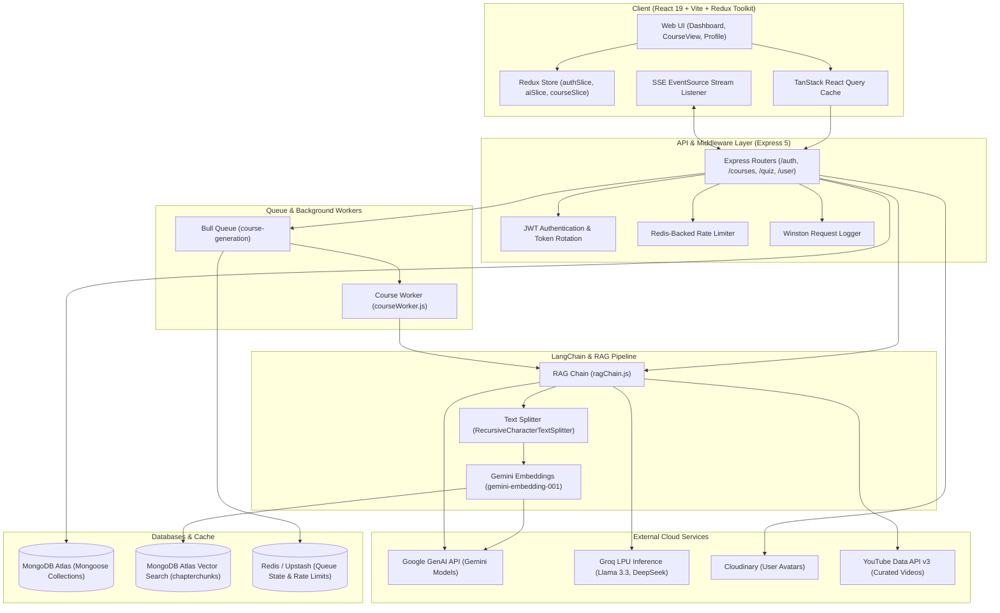
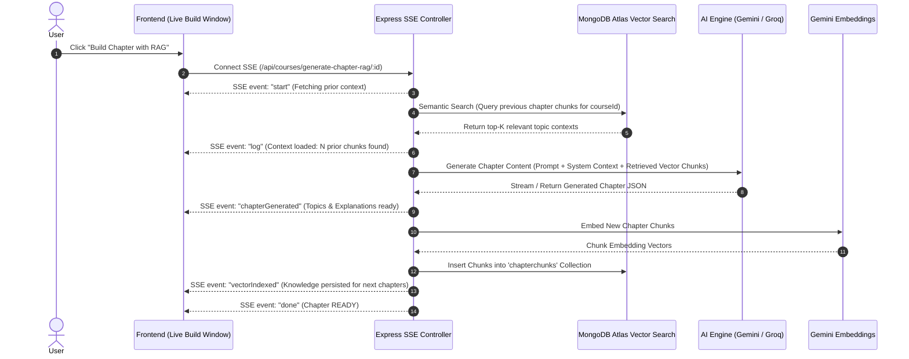
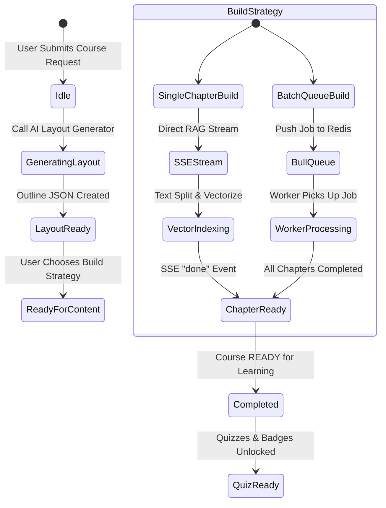

# 🚀 Primer

> **Next-Generation Autonomous AI Course Generation & Interactive Learning Platform**  
> Powered by Multi-Provider LLMs (Google Gemini & Groq Cloud), LangChain RAG with MongoDB Atlas Vector Search, BullMQ Asynchronous Processing, and Real-Time SSE Streaming.

[](https://react.dev/)
[](https://vitejs.dev/)
[](https://nodejs.org/)
[](https://expressjs.com/)
[](https://www.mongodb.com/products/platform/atlas-vector-search)
[](https://redis.io/)
[](https://ai.google.dev/)
[](https://groq.com/)

---

## 📑 Table of Contents
- [Overview](#-overview)
- [Key Features](#-key-features)
- [System Architecture](#-system-architecture)
  - [High-Level Architecture](#high-level-architecture)
  - [RAG Chapter Generation Pipeline](#rag-chapter-generation-pipeline)
  - [Real-Time SSE Streaming & Queue Workflow](#real-time-sse-streaming--queue-workflow)
- [Tech Stack](#-tech-stack)
- [Database Schema & Vector Search Index](#-database-schema--vector-search-index)
- [Environment Variables](#-environment-variables)
- [Getting Started & Installation](#-getting-started--installation)
  - [Prerequisites](#prerequisites)
  - [1. Clone Repository](#1-clone-repository)
  - [2. Backend Setup](#2-backend-setup)
  - [3. Frontend Setup](#3-frontend-setup)
  - [4. Vector Search Index Setup in MongoDB](#4-vector-search-index-setup-in-mongodb)
- [Running the Application](#-running-the-application)
- [Project Directory Structure](#-project-directory-structure)
- [API Reference](#-api-reference)
- [Troubleshooting & FAQs](#-troubleshooting--faqs)
- [License & Acknowledgements](#-license--acknowledgements)

---

## 💡 Overview

**Primer** transforms syllabus planning, course creation, and online studying into an intelligent, autonomous pipeline. Rather than generating simple, static markdown, Primer acts as an AI instructional architect:
1. **Interactive Curriculum Structuring**: Generates rich course layouts (chapters, topics, durations) tailored to topic, difficulty level, and user requirements.
2. **Context-Aware Chapter Synthesis (RAG)**: Uses **LangChain** and **MongoDB Atlas Vector Search** to retain memory of previous chapters, ensuring each new chapter references concepts taught earlier without repetition or hallucination.
3. **Live Streaming Window (SSE)**: Streams content generation in real-time, showing live terminal logs, step-by-step token generation, and vector indexing progress.
4. **Interactive Quiz System**: Generates tailored assessments for every chapter and comprehensive final exams to assess mastery.
5. **BYOK (Bring Your Own Key)**: Offers zero-friction key integration for both Groq and Gemini, managed entirely client-side through Redux Toolkit with encrypted database storage.

---

## ✨ Key Features

- **⚡ Dual AI Engine Support (Gemini & Groq)**:
  - **Google Gemini**: State-of-the-art reasoning with `gemini-3.5-flash-lite`, `gemini-3-flash-preview`, and `gemini-3.8/3.7/3.6/3.5-flash`.
  - **Groq Cloud**: Blazing-fast LPU inference with `llama-3.3-70b-versatile`, `llama-3.1-8b-instant`, `deepseek-r1-distill-llama-70b`, `mixtral-8x7b-32768`, and `gemma2-9b-it`.
- **🧠 Hierarchical Vector RAG Architecture**:
  - Automatically splits generated chapter text with `RecursiveCharacterTextSplitter`.
  - Embeds chunks using Google GenAI embeddings (`gemini-embedding-001`).
  - Stores vectors in MongoDB Atlas with course, chapter, topic, and user metadata for semantic similarity retrieval.
- **📡 Server-Sent Events (SSE) Live Build Window**:
  - Chapter-by-chapter live building with token-by-token progress, vector storage notifications, and fallback recovery indicators.
- **🔄 Asynchronous Queue Processing (BullMQ + Redis)**:
  - Offloads full course generation into a Redis-backed Bull queue with exponential backoff retries and stall mitigation.
- **🎓 Personalized Student Workspace**:
  - **Dashboard**: Instant overview of active user courses and public preview demo courses.
  - **Continue Learning**: Dedicated tracker for enrolled courses with progress bars.
  - **My Quizzes**: Quiz history, passing percentages, retake options, and quiz deletion.
  - **Profile Management**: Cloudinary-powered avatar upload, user stats, and interactive provider default configurations.
- **🔒 Enterprise-Grade Security & Hardening**:
  - Dual JWT authentication (short-lived access tokens + HTTP-only refresh tokens with auto-rotation).
  - Redis-backed rate limiting to defend against API abuse.
  - Role-Based Access Control (Admin vs Regular User) with secured public preview course management.

---

## 🏛 System Architecture

### High-Level Architecture



---

### RAG Chapter Generation Pipeline



---

### Real-Time SSE Streaming & Queue Workflow



---

## 🛠 Tech Stack

### Frontend (`/client`)
| Technology | Description |
| :--- | :--- |
| **React 19** | Modern UI components, hooks, concurrent rendering |
| **Vite 8** | Lightning-fast development server & optimized build pipeline |
| **Redux Toolkit** | Centralized reactive global state (`authSlice`, `aiSlice`, `courseSlice`) |
| **TanStack React Query v5** | Server-state caching, automatic background invalidation & mutation handling |
| **React Router v7** | Declarative client-side routing, protected routes, nested workspace layouts |
| **TailwindCSS v4 & Vanilla CSS** | Glassmorphic, dark-mode design system with curated gradients & micro-animations |
| **Axios** | HTTP client with automatic JWT token refresh interceptors |

### Backend (`/server`)
| Technology | Description |
| :--- | :--- |
| **Node.js & Express 5** | RESTful API architecture, SSE streaming, middleware pipelines |
| **MongoDB & Mongoose 9** | NoSQL database modeling courses, users, enrollments, quizzes, and chunk vectors |
| **MongoDB Atlas Vector Search** | Vector index similarity search for LangChain RAG pipeline |
| **LangChain** | LLM orchestration (`RunnableSequence`, `ChatPromptTemplate`, `MongoDBAtlasVectorSearch`) |
| **BullMQ & ioredis** | Robust background job queue with Redis caching & retry mechanisms |
| **@google/genai & Groq SDK** | Official client SDKs for Google Gemini Flash & Groq LPU models |
| **Cloudinary SDK** | Cloud-hosted image storage for user profile avatars |
| **Winston Logger** | Structured application & HTTP request logging |
| **Rate Limit Redis** | Distributed IP-based rate limiting on sensitive endpoints |

---

## 🗄 Database Schema & Vector Search Index

### Core Mongoose Models

1. **User (`User.js`)**:
   - `name`, `email`, `password` (bcrypt hashed), `gender`, `avatar` (Cloudinary URL).
   - `apiKeys`: `{ groq: String, gemini: String }` (stored securely, masked on retrieval).
   - `role`: `"user"` or `"admin"`.
2. **Course (`Course.js`)**:
   - `cid`: Unique UUID.
   - `courseJson`: Course layout (title, description, level, totalDuration, chapters, topics).
   - `courseContent`: Array of generated chapter contents, markdown, and associated YouTube videos.
   - `status`: `"PENDING"`, `"GENERATING"`, `"READY"`, or `"FAILED"`.
   - `previewCourse`: Boolean flag distinguishing public demo preview courses from user courses.
3. **Enrollment (`Enrollment.js`)**:
   - `userId`, `courseId`, `progress` (0 - 100%), `completedTopics` array, `completedChapters` array.
4. **Quiz (`Quiz.js`)**:
   - `userId`, `courseId`, `chapterIndex` (-1 for final quiz), `questions`, `score`, `passed`, `attempted`.
5. **ChapterChunk (`chapterchunks` collection)**:
   - `content`: Extracted text from chapter topics.
   - `embedding`: Vector array (768 dimensions from `gemini-embedding-001`).
   - `metadata`: `{ courseId, chapterIndex, chapterName, userId, chunkIndex }`.

### MongoDB Atlas Vector Search Index Definition

Create a Vector Search Index on the `chapterchunks` collection in MongoDB Atlas named `chapter_embedding_index`:

```json
{
  "fields": [
    {
      "numDimensions": 768,
      "path": "embedding",
      "similarity": "cosine",
      "type": "vector"
    },
    {
      "path": "metadata.courseId",
      "type": "filter"
    },
    {
      "path": "metadata.userId",
      "type": "filter"
    }
  ]
}
```

---

## 🔑 Environment Variables

### Backend (`server/.env`)

Create a `.env` file in the `server` directory:

```env
# Server Configuration
PORT=5005
NODE_ENV=development
CLIENT_URL=http://localhost:5173

# Database Connection
MONGO_URI=mongodb+srv://<username>:<password>@cluster0.mongodb.net/primer?retryWrites=true&w=majority

# JWT Authentication Secrets
JWT_ACCESS_SECRET=your_jwt_access_secret_key_min_32_characters
JWT_REFRESH_SECRET=your_jwt_refresh_secret_key_min_32_characters

# Redis Configuration (Local Redis or Upstash)
REDIS_HOST=127.0.0.1
REDIS_PORT=6379
REDIS_PASSWORD=
# UPSTASH_REDIS_URL=rediss://default:<token>@<host>:6379

# AI Provider System Keys (Fallback if user does not provide personal BYOK key)
GEMINI_API_KEY=AIzaSy...your_gemini_api_key
GROQ_API_KEY=gsk_...your_groq_api_key

# YouTube Data API (Curated Video Recommendations)
YOUTUBE_API_KEY=AIzaSy...your_youtube_api_key

# Cloudinary (User Avatar Uploads)
CLOUDINARY_CLOUD_NAME=your_cloudinary_cloud_name
CLOUDINARY_API_KEY=your_cloudinary_api_key
CLOUDINARY_API_SECRET=your_cloudinary_api_secret

# Administrator Configuration
ADMIN_EMAIL=your_admin_email@example.com
PREVIEW_COURSE_PASSWORD=your_secure_preview_course_password
```

### Frontend (`client/.env`)

Create a `.env` file in the `client` directory:

```env
VITE_API_URL=http://localhost:5005/api
```

---

## 🚀 Getting Started & Installation

### Prerequisites

- **Node.js**: v18.0.0 or higher
- **npm** or **pnpm** / **yarn**
- **MongoDB Atlas** account (with Vector Search enabled)
- **Redis Server** (Local via Redis CLI / Docker, or cloud via Upstash)
- **Google Gemini API Key** ([Google AI Studio](https://aistudio.google.com/))
- **Groq API Key** ([Groq Cloud Console](https://console.groq.com/))

---

### 1. Clone Repository

```bash
git clone https://github.com/githimanshu29/primer.git
cd primer
```

---

### 2. Backend Setup

```bash
# Navigate to server directory
cd server

# Install dependencies
npm install

# Configure environment variables
cp .env.example .env
# Edit .env with your credentials

# Start development server
npm run dev
```

The backend server will run on `http://localhost:5005`.

---

### 3. Frontend Setup

Open a new terminal window:

```bash
# Navigate to client directory
cd client

# Install dependencies
npm install

# Configure environment variables
# Ensure VITE_API_URL is set in .env
# VITE_API_URL=http://localhost:5005/api

# Start client development server
npm run dev
```

The frontend application will run on `http://localhost:5173`.

---

### 4. Vector Search Index Setup in MongoDB

1. Open your **MongoDB Atlas** dashboard.
2. Navigate to your cluster → **Atlas Search / Vector Search**.
3. Click **Create Search Index** → choose **JSON Editor**.
4. Select database and collection `chapterchunks`.
5. Enter the index name: `chapter_embedding_index`.
6. Paste the JSON configuration provided in the [Vector Search Index Definition](#mongodb-atlas-vector-search-index-definition) section.
7. Click **Create Search Index**.

---

## 🖥 Running the Application

| Service | Command | Address |
| :--- | :--- | :--- |
| **Client (Vite Dev Server)** | `cd client && npm run dev` | `http://localhost:5173` |
| **Server (Express + Workers)** | `cd server && npm run dev` | `http://localhost:5005` |
| **Redis Server** | `redis-server` (or Docker / Upstash) | `127.0.0.1:6379` |

---

## 📂 Project Directory Structure

```plaintext
primer/
├── client/                               # Frontend React 19 Application
│   ├── public/                           # Static assets & favicons
│   ├── src/
│   │   ├── components/ui/layout/         # Layouts, Sidebar, ProtectedRoute, WorkspaceLayout
│   │   ├── hooks/                        # Custom hooks (useAuth.js)
│   │   ├── lib/                          # API client, Axios interceptors, models metadata
│   │   │   ├── api.js                    # Endpoints & SSE EventSource connections
│   │   │   ├── axios.js                  # Axios instance with 401 token refresh interceptor
│   │   │   ├── models.js                 # Gemini & Groq model metadata & options
│   │   │   └── useUserProfile.js         # TanStack Query cached user profile hook
│   │   ├── pages/
│   │   │   ├── auth/                     # Login & Register views
│   │   │   ├── course/                   # Course view, ChapterSidebar, ChapterContent, QuizModal
│   │   │   └── workspace/                # Dashboard, Profile, StepBuilder, ContinueLearning, Quizzes
│   │   ├── store/                        # Redux Toolkit Store
│   │   │   ├── slices/                   # authSlice.js, aiSlice.js, courseSlice.js
│   │   │   └── store.js                  # Store configuration & reducer registration
│   │   ├── App.jsx                       # Application route definitions
│   │   └── main.jsx                      # App root with Redux Provider & QueryClientProvider
│   ├── package.json
│   └── vite.config.js
│
├── server/                               # Backend Node.js / Express Application
│   ├── server.js                         # Server entry point, middleware, DB connection & graceful shutdown
│   ├── src/
│   │   ├── config/                       # Database connection (db.js)
│   │   ├── controllers/                  # Route controllers (auth, course, quiz, user, enrollment)
│   │   ├── lib/
│   │   │   ├── cloudinary.js             # Avatar upload client
│   │   │   ├── groq.js                   # Groq & Gemini model generation & test helpers
│   │   │   ├── logger.js                 # Winston logger configuration
│   │   │   ├── redis.js                  # Redis client instance
│   │   │   └── langchain/                # Vector store, embeddings & RAG chains
│   │   │       ├── embeddings.js         # Google GenAI embeddings adapter
│   │   │       ├── ragChain.js           # Multi-provider LangChain RAG pipeline
│   │   │       ├── splitter.js           # Recursive character text splitting
│   │   │       └── vectorStore.js        # MongoDB Atlas Vector Search integration
│   │   ├── middleware/                   # JWT auth, rateLimiter, errorHandler, requestLogger
│   │   ├── models/                       # Mongoose models (User, Course, Enrollment, Quiz)
│   │   ├── queues/                       # BullMQ queue & background worker
│   │   │   ├── courseQueue.js            # Bull queue declaration & event listeners
│   │   │   └── workers/courseWorker.js   # Background worker for course batch generation
│   │   └── routes/                       # Express routes (auth, course, enrollment, quiz, user)
│   └── package.json
└── README.md
```

---

## 📡 API Reference

### Authentication (`/api/auth`)
| Method | Endpoint | Description | Protected |
| :--- | :--- | :--- | :--- |
| `POST` | `/api/auth/register` | Register new account & return JWT credentials | No |
| `POST` | `/api/auth/login` | Login with email/password & return tokens | No |
| `POST` | `/api/auth/refresh-token`| Rotate & issue new access token from refresh cookie | No |
| `POST` | `/api/auth/logout` | Invalidate refresh token & clear cookie | Yes |

### Courses & Generation (`/api/courses`)
| Method | Endpoint | Description | Protected |
| :--- | :--- | :--- | :--- |
| `POST` | `/api/courses/create` | Generate course curriculum layout via AI | Yes |
| `GET` | `/api/courses/my-courses` | Get authenticated user's regular courses | Yes |
| `GET` | `/api/courses/preview-courses` | Get public preview demo courses | Yes |
| `GET` | `/api/courses/:courseId` | Get detailed course layout & content by ID | Yes |
| `GET` | `/api/courses/generate-chapter-rag/:id` | **SSE Stream**: Generate chapter with RAG | Yes (Query Token) |
| `POST` | `/api/courses/generate-content` | Queue full course generation in BullMQ | Yes |
| `DELETE`| `/api/courses/:courseId` | Delete user course (Admin only for preview) | Yes |

### User Profile & AI Keys (`/api/user`)
| Method | Endpoint | Description | Protected |
| :--- | :--- | :--- | :--- |
| `GET` | `/api/user/profile` | Get user profile details, stats & key status | Yes |
| `PUT` | `/api/user/profile` | Update profile name, gender, or avatar | Yes |
| `PUT` | `/api/user/api-keys` | Save personal Groq or Gemini API keys (BYOK)| Yes |
| `POST` | `/api/user/test-api-key` | Test connection for given provider and model | Yes |
| `POST` | `/api/user/upload-avatar` | Upload profile avatar to Cloudinary | Yes |

### Quizzes & Progress (`/api/quiz` & `/api/enrollments`)
| Method | Endpoint | Description | Protected |
| :--- | :--- | :--- | :--- |
| `POST` | `/api/quiz/generate` | Generate AI quiz for chapter or final exam | Yes |
| `POST` | `/api/quiz/submit` | Submit quiz answers and verify score | Yes |
| `GET` | `/api/quiz/user-quizzes` | Fetch user's completed quizzes & stats | Yes |
| `DELETE`| `/api/quiz/:quizId` | Delete a recorded quiz attempt | Yes |
| `POST` | `/api/enrollments/enroll/:id`| Enroll in a course | Yes |
| `POST` | `/api/enrollments/complete-topic`| Mark topic complete & update progress | Yes |

---

## ❓ Troubleshooting & FAQs

### 1. Getting a `404: models/gemini-2.5-flash is no longer available`?
Google deprecated `gemini-2.5-flash` for new API projects. Primer uses `gemini-3.5-flash-lite` as the default Gemini model and provides selectable Gemini 3 Flash options (`gemini-3-flash-preview`, `gemini-3.8-flash`, etc.). If testing keys in the Profile page, verify that `gemini-3.5-flash-lite` or another active model is selected.

### 2. Bull queue jobs are failing or stalling?
Ensure your Redis instance is running and accessible at `REDIS_HOST:REDIS_PORT`. If using Upstash Redis in production, ensure `NODE_ENV=production` and `UPSTASH_REDIS_URL` is set with the `rediss://` protocol.

### 3. Vector search returns no results or empty context?
Verify that you created the Vector Search Index in MongoDB Atlas with the exact name `chapter_embedding_index` on the `chapterchunks` collection, and that `numDimensions` is set to `768`.

### 4. SSE (Server-Sent Events) connection disconnects prematurely?
Check that reverse proxies (like Nginx or Cloudflare) have buffering disabled (`proxy_buffering off;`) and that CORS headers allow credentials from your client origin.

---

## 📄 License & Acknowledgements

This project is licensed under the **ISC License**.

- Built with [LangChain](https://js.langchain.com/)
- LLM inference by [Google Gemini](https://ai.google.dev/) and [Groq Cloud](https://groq.com/)
- Vector search by [MongoDB Atlas](https://www.mongodb.com/products/platform/atlas-vector-search)
- Icons & UI inspirations from [Lucide Icons](https://lucide.dev/) and modern glassmorphic design paradigms.
